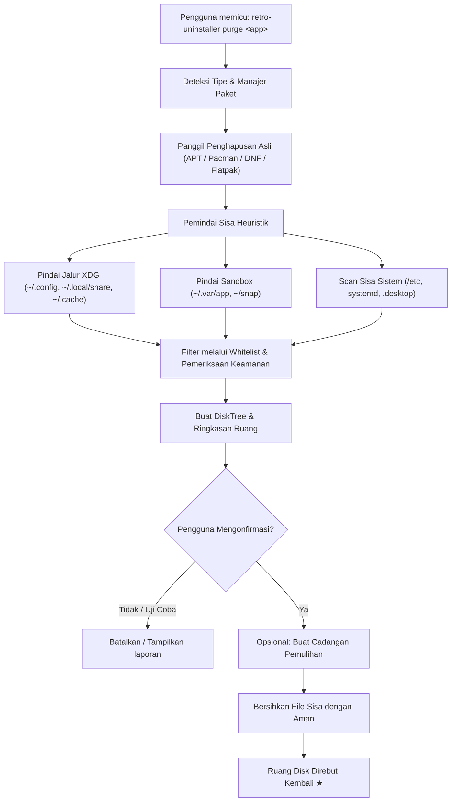

```markdown
# 🕹️ retro-uninstaller[cite: 1]

<p align="center">
  <pre align="center">
  ______ _____ _____ _____  _____        _   _ _   _ _____ _____ ___  _     _     ___________ 
  | ___ \  ___|_   _| ___ \/  _  \      | | | | \ | |_   _/  ___|_  || |   | |   |  ___| ___ \
  | |_/ / |__   | | | |_/ /| | | |______| | | |  \| | | | \ `--.  | || |   | |   | |__ | |_/ /
  |    /|  __|  | | |    / | | | |______| | | | . ` | | |  `--. \ | || |   | |   |  __||    / 
  | |\ \| |___  | | | |\ \ \ \_/ /      | |_| | |\  |_| |_/\__/ /_| || |___| |___| |___| |\ \ 
  \_| \_\____/  \_/ \_| \_| \___/        \___/\_| \_/\___/\____/\___/\_____/\_____/____/ \_| \_\
  </pre>
</p>

<p align="center">
  <strong>The deep, residual-hunting uninstaller & disk visualizer for the Linux terminal.</strong><br>
  <em>Think Revo Uninstaller meets DiskTree / ncdu — ultra-lightweight, blazing fast, and 100% open source.</em>[cite: 1]
</p>

<p align="center">
  <a href="LICENSE"></a>
  <a href="https://github.com/"></a>
  <a href="https://github.com/"></a>
  <a href="https://github.com/"></a>
</p>

---

## 📌 Table of Contents[cite: 1]

- [Overview](#-overview)[cite: 1]
- [The Problem vs. The Solution](#-the-problem-vs-the-solution)[cite: 1]
- [Terminal Preview](#-terminal-preview)[cite: 1]
- [Key Features](#-key-features)[cite: 1]
- [Installation](#-installation)[cite: 1]
- [Quick Start & Common Workflows](#-quick-start--common-workflows)[cite: 1]
- [Command-Line Reference](#-command-line-reference)[cite: 1]
- [Configuration](#-configuration)[cite: 1]
- [How It Works (Under the Hood)](#-how-it-works-under-the-hood)[cite: 1]
- [Safety & Whitelist Safeguards](#-safety--whitelist-safeguards)[cite: 1]
- [Roadmap](#-roadmap)[cite: 1]
- [Contributing](#-contributing)[cite: 1]
- [License & Acknowledgments](#-license--acknowledgments)[cite: 1]

---

## 💡 Overview[cite: 1]

When you remove software on Linux using traditional package managers (`apt remove`, `pacman -R`, `dnf remove`), only core system binaries are touched. Months later, your `$HOME` directory and system roots accumulate gigabytes of forgotten digital clutter:[cite: 1]

* Konfigurasi aplikasi tertinggal di `~/.config/`[cite: 1]
* Tumpukan cache di `~/.cache/` dan data runtime di `~/.local/share/`[cite: 1]
* Sampah runtime terisolasi dari paket sandboxed (direktori Flatpak `~/.var/app/` dan Snap)[cite: 1]
* Peluncur `.desktop` yang tertinggal, ikon kustom, dan unit pengguna `systemd` yang mati[cite: 1]

**`retro-uninstaller`** adalah utilitas terminal yang sangat cepat dan bebas dependensi yang dibangun untuk menyelesaikan masalah ini sekali untuk selamanya. Utilitas ini memadukan penghapusan file sisa pemindaian mendalam (terinspirasi oleh **Revo Uninstaller**) dengan analisis pohon penggunaan disk hierarkis (terinspirasi oleh **DiskTree** dan `ncdu`), dikemas dalam pengalaman CLI terminal retro yang apik dan bernostalgia.[cite: 1]

---

## ⚖️ The Problem vs. The Solution[cite: 1]

| What Gets Handled | Standard Package Managers (`apt`, `pacman`, etc.) | Flatpak / Snap Defaults | `retro-uninstaller` 🚀 |
| :--- | :---: | :---: | :---: |
| **System Binaries (`/usr/bin`, `/bin`)**[cite: 1] | ✅ Dihapus[cite: 1] | ✅ Dihapus[cite: 1] | ✅ Dibersihkan[cite: 1] |
| **Global Configs (`/etc`)**[cite: 1] | ⚠️ Hanya dengan `--purge`[cite: 1] | ❌ Dilewati[cite: 1] | ✅ Dipindai & Dibersihkan[cite: 1] |
| **User Configurations (`~/.config`)**[cite: 1] | ❌ Tidak pernah disentuh[cite: 1] | ❌ Tidak pernah disentuh[cite: 1] | ✅ Dipindai mendalam & Dibersihkan[cite: 1] |
| **Application Data (`~/.local/share`)**[cite: 1] | ❌ Tidak pernah disentuh[cite: 1] | ❌ Tidak pernah disentuh[cite: 1] | ✅ Dipindai mendalam & Dibersihkan[cite: 1] |
| **Caches & Temp Logs (`~/.cache`)**[cite: 1] | ❌ Tertinggal selamanya[cite: 1] | ❌ Tertinggal selamanya[cite: 1] | ✅ Diidentifikasi & Direbut kembali[cite: 1] |
| **Dead `.desktop` & Icon Entries**[cite: 1] | ⚠️ Sering menjadi tertinggal[cite: 1] | ⚠️ Sering menjadi tertinggal[cite: 1] | ✅ Terdeteksi & Dibersihkan[cite: 1] |
| **Sandboxed Residue (`~/.var/app/`)**[cite: 1] | ❌ Diabaikan[cite: 1] | ⚠️ Butuh perintah manual[cite: 1] | ✅ Ditemukan otomatis[cite: 1] |
| **Interactive Disk Tree Breakdown**[cite: 1] | ❌ Tidak ada[cite: 1] | ❌ Tidak ada[cite: 1] | ✅ DiskTree CLI Bawaan[cite: 1] |
| **Pre-deletion Safety Dry-Run**[cite: 1] | ⚠️ Minimal[cite: 1] | ❌ Tidak ada[cite: 1] | ✅ Pratinjau interaktif & pencadangan[cite: 1] |

---

## 🖥️ Terminal Preview[cite: 1]

### 1. Deep Residual Purge (`retro-uninstaller purge <package>`)[cite: 1]


```

$ retro-uninstaller purge discord

## [RETRO-UNINSTALLER v1.0.0]

## Target: discord (Terinstal via Flatpak & Sisa Pacman terdeteksi)

[*] Fase 1: Uninstalisasi Asli
-> Menjalankan flatpak uninstall com.discordapp.Discord ... [SELESAI]

[*] Fase 2: Memindai Sisa Artefak secara Mendalam...
[!] Ditemukan 5 jalur sisa terkait dengan 'discord':

## TIPE     UKURAN     JALUR

## CONFIG   4.2 MB     ~/.config/discord
DATA     148.6 MB   ~/.local/share/discord
CACHE    842.1 MB   ~/.cache/discord
SANDBOX  1.1 GB     ~/.var/app/com.discordapp.Discord
DESKTOP  1.2 KB     ~/.local/share/applications/discord.desktop

Total Ruang yang Dapat Direbut Kembali: 2.09 GB

[?] Rebut kembali 2.09 GB dengan membersihkan jalur-jalur ini dengan aman? [Y/n/select]: y
[+] Membuat titik pemulihan keamanan di ~/.cache/retro-uninstaller/backups/
[+] Membersihkan artefak...
✓ Menghapus ~/.config/discord
✓ Menghapus ~/.local/share/discord
✓ Menghapus ~/.cache/discord
✓ Menghapus ~/.var/app/com.discordapp.Discord
✓ Menghapus discord.desktop

[★] Selesai! Ruang disk sebesar 2.09 GB berhasil direbut kembali. Sistem bersih.

```

### 2. DiskTree Visualizer (`retro-uninstaller tree <package|path>`)[cite: 1]


```

$ retro-uninstaller tree lutris

[RETRO-UNINSTALLER DISKTREE]
Menganalisis penggunaan disk untuk: lutris
Total Penggunaan Disk: 4.82 GB di 3 lokasi

lutris (4.82 GB)
├── 📁 ~/.local/share/lutris (4.51 GB) [93.5%]
│   ├── 📁 runners (3.82 GB)
│   │   ├── 📁 wine (3.10 GB)
│   │   └── 📁 dxvk (720.0 MB)
│   ├── 📁 banners (45.2 MB)
│   └── 📄 pga.db (1.8 MB)
├── 📁 ~/.cache/lutris (298.4 MB) [6.1%]
│   ├── 📁 installer (240.0 MB)
│   └── 📁 covers (58.4 MB)
└── 📁 ~/.config/lutris (12.2 MB) [0.4%]
└── 📄 lutris.conf (4.1 KB)

Pilih tindakan: [P]urge semua | [T]rim Cache saja | [E]luar (Exit):

```

---

## ✨ Key Features[cite: 1]

* **🔍 Pembersih Sisa Mendalam:** Secara otomatis melintasi jalur standar XDG (`$XDG_CONFIG_HOME`, `$XDG_DATA_HOME`, `$XDG_CACHE_HOME`), `/etc`, `/var`, `~/.var/app`, unit pengguna systemd, dan pintasan desktop aplikasi.[cite: 1]
* **🌲 Visualisator DiskTree Bawaan:** Pemeriksaan disk interaktif berstruktur pohon. Lihat dengan tepat direktori, cabang cache, atau folder tersembunyi mana yang memakan ruang disk sebelum mengambil tindakan.[cite: 1]
* **📦 Agnostik Multi-Package Manager:** Bekerja berdampingan dengan:[cite: 1]
  * **Pacman / AUR** (Arch, Manjaro, EndeavourOS)[cite: 1]
  * **APT** (Debian, Ubuntu, Mint, Pop!_OS)[cite: 1]
  * **DNF** (Fedora, RHEL)[cite: 1]
  * **Zypper** (openSUSE)[cite: 1]
  * **Flatpak & Snap**[cite: 1]
  * **AppImages & Instalasi biner mandiri** di `~/.local/bin` atau `/opt`[cite: 1]
* **🛡️ Mesin Keamanan Andal:**[cite: 1]
  * **Whitelist Kritis Sistem:** Penjaga hard-coded mencegah penyentuhan `/bin`, `/boot`, `/usr/lib`, `/etc/shadow`, `$HOME`, atau folder pribadi pengguna (Dokumen, Gambar, dll.).[cite: 1]
  * **Mode Uji Coba (`-n`, `--dry-run`):** Periksa file persis yang akan dihapus tanpa menyentuh konten disk.[cite: 1]
  * **Pencadangan Otomatis (`--backup`):** Mengarsipkan sisa file ke dalam file tarball sebelum penghapusan sehingga penghapusan yang tidak disengaja dapat dipulihkan seketika.[cite: 1]
* **⚡ CLI Murni & Tanpa Bloat:** Ditulis tanpa dependensi GUI yang berat. Dimulai dalam hitungan milidetik, berjalan lancar melalui SSH, dan menghargai sumber daya sistem.[cite: 1]
* **📟 Nuansa Terminal Retro:** Batas ASCII yang tajam, tema warna fosfor hijau/amber opsional, dan metrik yang ramah manusia (KB, MB, GB).[cite: 1]

---

## 📥 Installation[cite: 1]

### Method 1: Automated Script (Recommended)[cite: 1]

```bash
curl -fsSL [https://raw.githubusercontent.com/your-username/retro-uninstaller/main/install.sh](https://raw.githubusercontent.com/your-username/retro-uninstaller/main/install.sh) | bash

```

### Method 2: Package Managers


#### Arch Linux (AUR)


```bash
paru -S retro-uninstaller
# atau
yay -S retro-uninstaller

```

#### Debian / Ubuntu (.deb)


Unduh `.deb` terbaru dari halaman [Releases](https://www.google.com/search?q=https://github.com/your-username/retro-uninstaller/releases):

```bash
sudo dpkg -i retro-uninstaller_amd64.deb
sudo apt-get install -f

```

#### Fedora / RHEL (.rpm)


```bash
sudo rpm -i retro-uninstaller.rpm

```

### Method 3: Build from Source


```bash
git clone [https://github.com/your-username/retro-uninstaller.git](https://github.com/your-username/retro-uninstaller.git)
cd retro-uninstaller
make build
sudo make install

```

---

## 🚀 Quick Start & Common Workflows


### 1. Perform a Complete, Clean Uninstallation


Menghapus paket melalui package manager sistem Anda, lalu melacak dan membersihkan semua file pengguna tersembunyi:

```bash
retro-uninstaller purge <package-name>

```

### 2. Visualize an Application's Disk Usage


Menampilkan rincian DiskTree visual dari tempat aplikasi menyimpan file dan cache:

```bash
retro-uninstaller tree <package-name>

```

### 3. Scan for Leftovers from Already-Deleted Apps


Menemukan sisa tertinggal dari perangkat lunak yang Anda hapus beberapa minggu lalu menggunakan package manager biasa:

```bash
retro-uninstaller scan --orphans

```

### 4. Run a Safe Dry Run


Melihat semua hal yang *akan* dihapus tanpa membuat perubahan nyata pada sistem file:

```bash
retro-uninstaller purge <package-name> --dry-run

```

### 5. Create a Rollback Backup


Mengompresi sisa-sisa ke dalam arsip berstempel waktu sebelum dibersihkan:

```bash
retro-uninstaller purge <package-name> --backup

```

---

## 📖 Command-Line Reference


```
Penggunaan: retro-uninstaller <PERINTAH> [OPSI] [TARGET]

Perintah:
  purge <pkg>       Menghapus perangkat lunak dan membersihkan semua data/konfigurasi/cache sisa
  tree <pkg|path>   Menampilkan DiskTree interaktif dari ukuran paket atau direktori
  scan              Memindai sistem untuk paket tertinggal, konfigurasi rusak, dan tautan mati
  clean             Pembersihan cepat cache aplikasi dan folder sementara yang dikenal
  restore <file>    Memulihkan file yang dibersihkan dari arsip pemulihan sebelumnya
  version           Mencetak detail versi retro-uninstaller

Opsi:
  -d, --deep        Mengaktifkan pemindaian heuristik mendalam (mencari dotfile kustom dan jalur XDG)
  -n, --dry-run     Mensimulasikan penghapusan dan mencetak file yang cocok tanpa menghapus
  -b, --backup      Membuat arsip pemulihan terkompresi sebelum penghapusan
  -y, --yes         Melewati prompt konfirmasi interaktif (mode skrip)
  -t, --tree        Menampilkan hierarki DiskTree sebelum meminta konfirmasi
  -v, --verbose     Output detail dengan log pemindaian terperinci
  -c, --color <thm> Tema terminal: 'retro-green', 'amber', 'cyber', atau 'plain'
  -h, --help        Menampilkan bantuan dan keluar

```

---

## ⚙️ Configuration


`retro-uninstaller` beroperasi secara lancar langsung tanpa pengaturan awal, tetapi Anda dapat menyesuaikan aturan, gaya tema, dan daftar perlindungan (safelist) di `~/.config/retro-uninstaller/config.toml`:

```toml
[general]
theme = "retro-green"         # Pilihan: retro-green, amber, cyan, plain
confirm_prompt = true         # Selalu tanya sebelum penghapusan file
auto_backup = true            # Buat arsip pemulihan saat pembersihan mendalam

[paths]
# Lokasi pencarian tambahan untuk aplikasi berpemilik atau self-hosted
custom_scan_dirs = [
    "~/.wine/drive_c/Program Files",
    "~/Applications"
]

[safelist]
# Jalur yang TIDAK AKAN PERNAH disentuh oleh retro-uninstaller dalam kondisi apa pun
protected = [
    "/etc/fstab",
    "/etc/passwd",
    "~/.ssh",
    "~/.gnupg",
    "~/Documents",
    "~/Pictures"
]

```

---

## 🔍 How It Works (Under the Hood)




1. **Identifikasi Manajer:** Secara otomatis memeriksa apakah program diinstal melalui paket asli (`pacman`, `apt`, `dnf`), kontainer universal (`flatpak`, `snap`), atau jalur kustom (`/opt`, `~/.local/bin`).


2. **Penghapusan Paket Asli:** Memanggil prosedur uninstalisasi standar package manager sistem.


3. **Pemindaian Heuristik Sisa:** Mencocokkan nama biner, string ID desktop, jalur vendor yang dikenal, dan pengenal proses terhadap lokasi penyimpanan umum.


4. **Pemeriksaan Keamanan:** Mengevaluasi setiap jalur target terhadap aturan pengecualian yang ketat dan whitelist untuk memastikan tidak ada konfigurasi penting atau dokumen pribadi yang terpengaruh.


5. **DiskTree Interaktif:** Menghitung ukuran penggunaan disk dan menghasilkan pohon konsumsi disk visual yang jelas dengan metrik ruang yang ramah manusia.


6. **Eksekusi & Pencadangan:** Secara opsional mengompresi target ke dalam arsip cadangan yang aman dan membersihkan sisa-sisa file secara sistematis.


---

## 🛡️ Safety & Whitelist Safeguards


`retro-uninstaller` dirancang dengan keamanan dan stabilitas sistem sebagai inti utamanya:

* 🚫 **Penguncian Root Kritis:** Penjaga hard-coded melindungi root sistem yang kritis (`/`, `/bin`, `/boot`, `/dev`, `/lib`, `/proc`, `/sys`, `/usr/bin`).


* 🚫 **Isolasi Data Pengguna:** Direktori pribadi pengguna (`~/Documents`, `~/Downloads`, `~/Pictures`, `~/Videos`, `~/.ssh`, `~/.gnupg`) masuk dalam daftar hitam ketat dari penghapusan otomatis.


* 🛡️ **Pilihan Ganda Interaktif:** Secara default, `retro-uninstaller` menampilkan daftar file per baris dan memerlukan verifikasi pengguna secara eksplisit sebelum menghapus tautan apa pun.


* 📦 **Dukungan Pembatalan Instan:** Jika Anda tidak sengaja membersihkan file dengan `--backup`, Anda dapat langsung memulihkannya menggunakan `retro-uninstaller restore <archive.tar.gz>`.


---

## 🗺️ Roadmap


* [x] Deteksi package manager inti (APT, Pacman, DNF, Flatpak)


* [x] Pemindai sisa sistem file mendalam (XDG + `.desktop` + `systemd`)


* [x] Visualisator ASCII DiskTree


* [x] Mekanisme pencadangan & pemulihan keamanan


* [ ] Mode TUI interaktif (antarmuka navigasi ncurses / bubbletea bawaan)


* [ ] Modul pembersihan kontainer/volume menggantung Docker & Podman


* [ ] Deteksi otomatis sisa prefix Wine / Proton


* [ ] Basis data definisi pembersihan paket yang dikelola komunitas


---

## 🤝 Contributing


Kontribusi membuat komunitas open-source menjadi tempat yang luar biasa untuk belajar, menginspirasi, dan berkarya. Segala bentuk kontribusi Anda sangat **dihargai**!

1. Fork Proyek Ini


2. Buat Cabang Fitur Anda (`git checkout -b feature/FiturKeren`)


3. Lakukan Commit pada Perubahan Anda (`git commit -m 'Menambahkan FiturKeren'`)


4. Dorong ke Cabang (`git push origin feature/FiturKeren`)


5. Buka Pull Request


Jangan ragu untuk memeriksa halaman [Issues](https://www.google.com/search?q=https://github.com/your-username/retro-uninstaller/issues) untuk melaporkan bug atau menyarankan fitur baru!

---

## 📜 License & Acknowledgments


Didistribusikan di bawah **Lisensi MIT**. Lihat [`LICENSE`](https://www.google.com/search?q=LICENSE) untuk informasi lebih lanjut.

### 💖 Inspired By


* **[Revo Uninstaller](https://www.revouninstaller.com/)** — Untuk perintisan penghapusan perangkat lunak yang menyeluruh dan mendalam.


* **DiskTree / [ncdu](https://dev.yorhel.nl/ncdu) / [dust**](https://github.com/bootandy/dust) — Untuk membuat visualisasi penggunaan disk terminal menjadi cepat, indah, dan intuitif.


---
