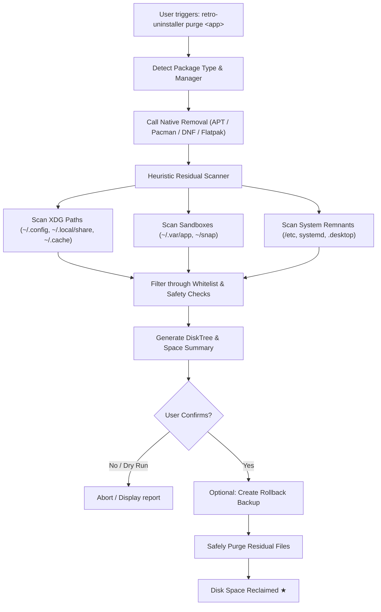

# 🕹️ retro-uninstaller

<h6 align="center">
  <pre align="center">               
 ______     ______     ______   ______     ______    
/\  == \   /\  ___\   /\__  _\ /\  == \   /\  __ \   
\ \  __<   \ \  __\   \/_/\ \/ \ \  __<   \ \ \/\ \  
 \ \_\ \_\  \ \_____\    \ \_\  \ \_\ \_\  \ \_____\ 
ㅤㅤㅤㅤㅤㅤㅤㅤㅤㅤㅤㅤㅤㅤㅤㅤ\/_/ /_/   \/_____/     \/_/   \/_/ /_/   \/_____/                                             
 __  __     __   __     __     __   __     ______     ______   ______     __         __         ______     ______    
/\ \/\ \   /\ "-.\ \   /\ \   /\ "-.\ \   /\  ___\   /\__  _\ /\  __ \   /\ \       /\ \       /\  ___\   /\  == \   
\ \ \_\ \  \ \ \-.  \  \ \ \  \ \ \-.  \  \ \___  \  \/_/\ \/ \ \  __ \  \ \ \____  \ \ \____  \ \  __\   \ \  __<   
 \ \_____\  \ \_\\"\_\  \ \_\  \ \_\\"\_\  \/\_____\    \ \_\  \ \_\ \_\  \ \_____\  \ \_____\  \ \_____\  \ \_\ \_\ 
  \/_____/   \/_/ \/_/   \/_/   \/_/ \/_/   \/_____/     \/_/   \/_/\/_/   \/_____/   \/_____/   \/_____/   \/_/ /_/ 
                                                                                                                     
                                                                                                                                                                             
                                    
  </pre>
</h6>

<p align="center">
  <strong>The deep, residual-hunting uninstaller & disk visualizer for the Linux terminal.</strong><br>
  <em>Think Revo Uninstaller meets DiskTree / ncdu — ultra-lightweight, blazing fast, and 100% open source.</em>
</p>

<p align="center">
  <a href="LICENSE"></a>
  <a href="https://github.com/"></a>
  <a href="https://github.com/"></a>
  <a href="https://github.com/"></a>
</p>

---

## 📌 Table of Contents

- [Overview](#-overview)
- [The Problem vs. The Solution](#-the-problem-vs-the-solution)
- [Terminal Preview](#-terminal-preview)
- [Key Features](#-key-features)
- [Installation](#-installation)
- [Quick Start & Common Workflows](#-quick-start--common-workflows)
- [Command-Line Reference](#-command-line-reference)
- [Configuration](#-configuration)
- [How It Works (Under the Hood)](#-how-it-works-under-the-hood)
- [Safety & Whitelist Safeguards](#-safety--whitelist-safeguards)
- [Roadmap](#-roadmap)
- [Contributing](#-contributing)
- [License & Acknowledgments](#-license--acknowledgments)

---

## 💡 Overview

When you remove software on Linux using traditional package managers (`apt remove`, `pacman -R`, `dnf remove`), only core system binaries are touched. Months later, your `$HOME` directory and system roots accumulate gigabytes of forgotten digital clutter:

* Orphaned application configs in `~/.config/`
* Cache heaps in `~/.cache/` and runtime data in `~/.local/share/`
* Isolated runtime junk from sandboxed packages (Flatpak `~/.var/app/` and Snap directories)
* Stranded `.desktop` launchers, custom icons, and dead `systemd` user units

**`retro-uninstaller`** is an ultra-fast, dependency-free terminal utility built to solve this once and for all. It pairs deep-scan residual file removal (inspired by **Revo Uninstaller**) with hierarchical disk usage tree analysis (inspired by **DiskTree** and `ncdu`), wrapped in a slick, nostalgic, retro-terminal CLI experience.

---

## ⚖️ The Problem vs. The Solution

| What Gets Handled | Standard Package Managers (`apt`, `pacman`, etc.) | Flatpak / Snap Defaults | `retro-uninstaller` 🚀 |
| :--- | :---: | :---: | :---: |
| **System Binaries (`/usr/bin`, `/bin`)** | ✅ Removed | ✅ Removed | ✅ Cleaned |
| **Global Configs (`/etc`)**              | ⚠️ Only with `--purge` | ❌ Skipped | ✅ Scanned & Purged |
| **User Configurations (`~/.config`)**    | ❌ Never touched | ❌ Never touched | ✅ Deep-scanned & Cleaned |
| **Application Data (`~/.local/share`)**  | ❌ Never touched | ❌ Never touched | ✅ Deep-scanned & Cleaned |
| **Caches & Temp Logs (`~/.cache`)**      | ❌ Lingers indefinitely | ❌ Lingers indefinitely | ✅ Identified & Reclaimed |
| **Dead `.desktop` & Icon Entries**       | ⚠️ Often orphaned | ⚠️ Often orphaned | ✅ Detected & Purged |
| **Sandboxed Residue (`~/.var/app/`)**    | ❌ Ignored | ⚠️ Manual command needed | ✅ Auto-discovered |
| **Interactive Disk Tree Breakdown**      | ❌ None | ❌ None | ✅ Built-in DiskTree CLI |
| **Pre-deletion Safety Dry-Run**          | ⚠️ Minimal | ❌ None | ✅ Interactive preview & backups |

---

## 🖥️ Terminal Preview

### 1. Deep Residual Purge (`retro-uninstaller purge <package>`)

```
$ retro-uninstaller purge discord

[RETRO-UNINSTALLER v1.0.0]
-------------------------------------------------------------------------
Target: discord (Installed via Flatpak & Pacman residue detected)
-------------------------------------------------------------------------

[*] Phase 1: Native Uninstallation
    -> Executing flatpak uninstall com.discordapp.Discord ... [DONE]

[*] Phase 2: Deep Scanning Residual Artifacts...
    [!] Found 5 leftover path(s) related to 'discord':

    TYPE     SIZE       PATH
    ---------------------------------------------------------------------
    CONFIG   4.2 MB     ~/.config/discord
    DATA     148.6 MB   ~/.local/share/discord
    CACHE    842.1 MB   ~/.cache/discord
    SANDBOX  1.1 GB     ~/.var/app/com.discordapp.Discord
    DESKTOP  1.2 KB     ~/.local/share/applications/discord.desktop
    ---------------------------------------------------------------------
    Total Reclaimable Space: 2.09 GB

[?] Reclaim 2.09 GB by safely purging these paths? [Y/n/select]: y
[+] Creating safety rollback point in ~/.cache/retro-uninstaller/backups/
[+] Purging artifacts...
    ✓ Removed ~/.config/discord
    ✓ Removed ~/.local/share/discord
    ✓ Removed ~/.cache/discord
    ✓ Removed ~/.var/app/com.discordapp.Discord
    ✓ Removed discord.desktop

[★] Complete! Reclaimed 2.09 GB of disk space. System is clean.
```

### 2. DiskTree Visualizer (`retro-uninstaller tree <package|path>`)

```
$ retro-uninstaller tree lutris

[RETRO-UNINSTALLER DISKTREE]
Analyzing disk footprint for: lutris
Total Disk Usage: 4.82 GB across 3 locations

lutris (4.82 GB)
├── 📁 ~/.local/share/lutris (4.51 GB) [93.5%]
│   ├── 📁 runners (3.82 GB)
│   │   ├── 📁 wine (3.10 GB)
│   │   └── 📁 dxvk (720.0 MB)
│   ├── 📁 banners (45.2 MB)
│   └── 📄 pga.db (1.8 MB)
├── 📁 ~/.cache/lutris (298.4 MB) [6.1%]
│   ├── 📁 installer (240.0 MB)
│   └── 📁 covers (58.4 MB)
└── 📁 ~/.config/lutris (12.2 MB) [0.4%]
    └── 📄 lutris.conf (4.1 KB)

Select action: [P]urge all | [T]rim Cache only | [E]xit: 
```

---

## ✨ Key Features

* **🔍 Deep Residual Sweeper:** Automatically traverses XDG standard paths (`$XDG_CONFIG_HOME`, `$XDG_DATA_HOME`, `$XDG_CACHE_HOME`), `/etc`, `/var`, `~/.var/app`, systemd user units, and application desktop shortcuts.
* **🌲 Built-in DiskTree Visualizer:** Interactive, tree-structured disk inspection. See exactly which directory, cache branch, or hidden folder is consuming disk space before taking action.
* **📦 Multi-Package Manager Agnostic:** Works alongside:
  * **Pacman / AUR** (Arch, Manjaro, EndeavourOS)
  * **APT** (Debian, Ubuntu, Mint, Pop!_OS)
  * **DNF** (Fedora, RHEL)
  * **Zypper** (openSUSE)
  * **Flatpak & Snap**
  * **AppImages & Standalone binary installs** in `~/.local/bin` or `/opt`
* **🛡️ Bulletproof Safety Engine:**
  * **System Critical Whitelist:** Hard-coded guardrails prevent touching `/bin`, `/boot`, `/usr/lib`, `/etc/shadow`, `$HOME`, or user personal folders (Documents, Pictures, etc.).
  * **Dry-Run Mode (`-n`, `--dry-run`):** Inspect exact files that would be removed without touching disk contents.
  * **Auto-Backups (`--backup`):** Archive remnants to a tarball prior to deletion so any accidental removal can be restored immediately.
* **⚡ Pure CLI & Zero Bloat:** Written with zero heavy GUI dependencies. Starts in milliseconds, runs smoothly over SSH, and respects system resources.
* **📟 Retro Terminal Vibes:** Crisp ASCII borders, optional green/amber phosphor color themes, and readable human-centric metrics (KB, MB, GB).

---

## 📥 Installation

### Method 1: Automated Script (Recommended)

```bash
curl -fsSL https://raw.githubusercontent.com/your-username/retro-uninstaller/main/install.sh | bash
```

### Method 2: Package Managers

#### Arch Linux (AUR)
```bash
paru -S retro-uninstaller
# or
yay -S retro-uninstaller
```

#### Debian / Ubuntu (.deb)
Download the latest `.deb` from the [Releases](https://github.com/your-username/retro-uninstaller/releases) page:
```bash
sudo dpkg -i retro-uninstaller_amd64.deb
sudo apt-get install -f
```

#### Fedora / RHEL (.rpm)
```bash
sudo rpm -i retro-uninstaller.rpm
```

### Method 3: Build from Source

```bash
git clone https://github.com/your-username/retro-uninstaller.git
cd retro-uninstaller
make build
sudo make install
```

---

## 🚀 Quick Start & Common Workflows

### 1. Perform a Complete, Clean Uninstallation
Uninstalls the package via your system package manager, then tracks down and purges all hidden user files:
```bash
retro-uninstaller purge <package-name>
```

### 2. Visualize an Application's Disk Usage
Display a visual DiskTree breakdown of where an application stores files and caches:
```bash
retro-uninstaller tree <package-name>
```

### 3. Scan for Orphaned Leftovers from Already-Deleted Apps
Find leftovers from software you removed weeks ago using ordinary package managers:
```bash
retro-uninstaller scan --orphans
```

### 4. Run a Safe Dry Run
See everything that *would* be deleted without making any real filesystem changes:
```bash
retro-uninstaller purge <package-name> --dry-run
```

### 5. Create a Rollback Backup
Compress remnants into a timestamped archive before purging:
```bash
retro-uninstaller purge <package-name> --backup
```

---

## 📖 Command-Line Reference

```
Usage: retro-uninstaller <COMMAND> [OPTIONS] [TARGET]

Commands:
  purge <pkg>       Uninstall software and purge all lingering data/config/cache
  tree <pkg|path>   Render an interactive DiskTree of package or directory weight
  scan              Scan system for orphaned packages, broken configs, and dead links
  clean             Quick-clean known application cache and temp folders
  restore <file>    Restore purged files from a previous rollback archive
  version           Print retro-uninstaller version details

Options:
  -d, --deep        Enable deep heuristic scanning (searches custom dotfiles and XDG paths)
  -n, --dry-run     Simulate uninstallation and print matching files without deleting
  -b, --backup      Create a compressed rollback archive before deletion
  -y, --yes         Skip interactive confirmation prompt (scripting mode)
  -t, --tree        Display DiskTree hierarchy before asking for confirmation
  -v, --verbose     Verbose output with fine-grained scan logs
  -c, --color <thm> Terminal theme: 'retro-green', 'amber', 'cyber', or 'plain'
  -h, --help        Show help and exit
```

---

## ⚙️ Configuration

`retro-uninstaller` operates seamlessly out of the box with zero setup, but you can customize rules, theme styles, and protection safelists in `~/.config/retro-uninstaller/config.toml`:

```toml
[general]
theme = "retro-green"         # Options: retro-green, amber, cyan, plain
confirm_prompt = true         # Always ask before file deletion
auto_backup = true            # Create rollback archive on deep purge

[paths]
# Additional search locations for proprietary or self-hosted apps
custom_scan_dirs = [
    "~/.wine/drive_c/Program Files",
    "~/Applications"
]

[safelist]
# Paths retro-uninstaller will NEVER touch under any circumstance
protected = [
    "/etc/fstab",
    "/etc/passwd",
    "~/.ssh",
    "~/.gnupg",
    "~/Documents",
    "~/Pictures"
]
```

---

## 🔍 How It Works (Under the Hood)



1. **Manager Identification:** Automatically checks whether the program was installed via native packaging (`pacman`, `apt`, `dnf`), universal containers (`flatpak`, `snap`), or custom paths (`/opt`, `~/.local/bin`).
2. **Native Package Removal:** Calls the system package manager's standard uninstall procedure.
3. **Residual Heuristic Scan:** Cross-references binary names, desktop ID strings, known vendor paths, and process identifiers against common storage locations.
4. **Safety Check:** Evaluates each target path against strict exclusion rules and whitelists to ensure no critical configuration or personal document is affected.
5. **Interactive DiskTree:** Computes disk footprints and outputs a clear, visual disk consumption tree with human-readable space metrics.
6. **Execution & Backup:** Optionally compresses targets into a safe backup archive and systematically purges the leftovers.

---

## 🛡️ Safety & Whitelist Safeguards

`retro-uninstaller` is engineered with security and system stability at its core:

* 🚫 **Critical Root Lockout:** Hard-coded guards protect critical system roots (`/`, `/bin`, `/boot`, `/dev`, `/lib`, `/proc`, `/sys`, `/usr/bin`).
* 🚫 **User Data Isolation:** Personal user directories (`~/Documents`, `~/Downloads`, `~/Pictures`, `~/Videos`, `~/.ssh`, `~/.gnupg`) are strictly blacklisted from automated deletion.
* 🛡️ **Interactive Multi-Choice:** By default, `retro-uninstaller` presents a line-by-line itemized file list and requires explicit user verification before unlinking anything.
* 📦 **Instant Undo Support:** If you purge a file by accident with `--backup`, you can instantly restore it using `retro-uninstaller restore <archive.tar.gz>`.

---

## 🗺️ Roadmap

- [x] Core package manager detection (APT, Pacman, DNF, Flatpak)
- [x] Deep file system residual scanner (XDG + `.desktop` + `systemd`)
- [x] ASCII DiskTree visualizer
- [x] Safety backup & restore mechanism
- [ ] Interactive TUI mode (built-in ncurses / bubbletea navigation interface)
- [ ] Docker & Podman dangling container/volume cleanup module
- [ ] Wine / Proton prefix residual auto-detection
- [ ] Community-maintained package cleanup definitions database

---

## 🤝 Contributing

Contributions make the open-source community an amazing place to learn, inspire, and create. Any contributions you make are **greatly appreciated**!

1. Fork the Project
2. Create your Feature Branch (`git checkout -b feature/AmazingFeature`)
3. Commit your Changes (`git commit -m 'Add some AmazingFeature'`)
4. Push to the Branch (`git push origin feature/AmazingFeature`)
5. Open a Pull Request

Feel free to check the [Issues](https://github.com/your-username/retro-uninstaller/issues) page to report bugs or suggest new features!

---

## 📜 License & Acknowledgments

Distributed under the **MIT License**. See [`LICENSE`](LICENSE) for more information.

### 💖 Inspired By
* **[Revo Uninstaller](https://www.revouninstaller.com/)** — For pioneering thorough, deep software removal.
* **DiskTree / [ncdu](https://dev.yorhel.nl/ncdu) / [dust](https://github.com/bootandy/dust)** — For making terminal disk usage visualization fast, beautiful, and intuitive.

---

<p align="center">
  <sub>Crafted with passion for the Linux terminal community. If you found this tool useful, give it a ⭐️ on GitHub!</sub>
</p>
